# เอกสารรายละเอียดเนื้อหาในแต่ละหน้า (MFU Kok Water Watch)
ระบบเฝ้าระวังคุณภาพน้ำและเตือนภัยลุ่มน้ำกก — มหาวิทยาลัยแม่ฟ้าหลวง

รวบรวมภาพหน้าจอจริงและคำอธิบายแบ่งตามฝั่งผู้ใช้งาน (User / หน้าบ้าน) และผู้ดูแลระบบ (Admin / หลังบ้าน)

---

## ส่วนที่ 1: หน้า User (ประชาชน, เกษตรกร, ชาวบ้านริมน้ำกก)

### 1. แผนที่สารเคมีปนเปื้อน (Chemical Contamination Map)
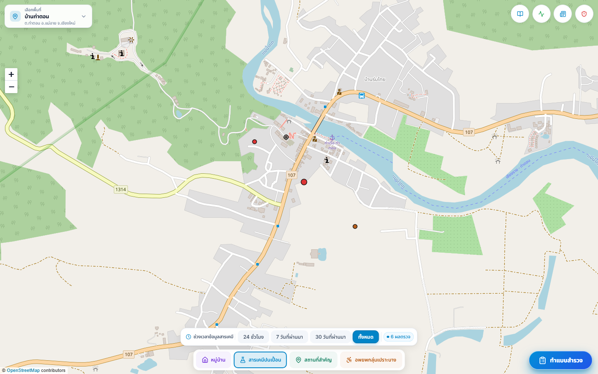
- **ผู้ใช้:** ชาวนา, เกษตรกร, ประชาชนริมน้ำกก, อาสาสมัครชุมชน
- **สถานะ/ปัญหาเดิม:** ไม่รู้ว่าน้ำกกหน้าบ้านมีสารหนูปนเปื้อนเกินเกณฑ์หรือไม่ สูบเข้านาหรือใช้อุปโภคได้ไหม ขาดข้อมูลเชิงพื้นที่แบบเรียลไทม์
- **สิ่งที่ได้กลับไป:** แผนที่ดาวเทียม/ถนน แสดงหมุดสี 9 ระดับ (<5 ถึง 500 ppb), ตัวกรองเวลา (24 ชั่วโมง, 7 วัน, 30 วัน, ทั้งหมด), การจัดกลุ่มหมุดใกล้เคียง (Clustering), และป้ายสถานะมาตรฐานควบคุมมลพิษ (คพ.)
- **นำไปใช้ประโยชน์ต่อ:** ตัดสินใจสูบน้ำเข้านา เลี่ยงการใช้น้ำในจุดที่มีการปนเปื้อนสูง และวางแผนการใช้น้ำร่วมกันในชุมชน

---

### 2. รายละเอียดจุดตรวจและประวัติผลตรวจ (Point Detail Modal)
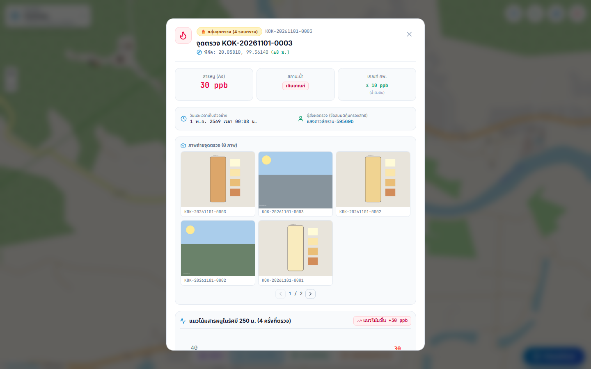
- **ผู้ใช้:** เกษตรกรเจ้าของแปลงใกล้จุดตรวจ, ผู้นำชุมชน, อาสาสมัคร
- **สถานะ/ปัญหาเดิม:** เห็นแต่หมุดบนแผนที่แต่ไม่รู้ว่าใครเป็นคนตรวจ ตรวจเมื่อไหร่ ค่าแนวโน้มในอดีตขึ้นหรือลง และมีภาพถ่ายหน้างานจริงยืนยันหรือไม่
- **สิ่งที่ได้กลับไป:** ข้อมูลค่าสารหนูล่าสุด (ppb), ประวัติการตรวจซ้ำย้อนหลัง, กราฟแนวโน้มสารหนูรายจุด, นามแฝงผู้ส่งตรวจ (ปกป้อง PDPA), วันที่เวลาเก็บตัวอย่าง, และภาพถ่ายชุดทดสอบแถบสีจริง
- **นำไปใช้ประโยชน์ต่อ:** ติดตามความเปลี่ยนแปลงของแหล่งน้ำเฉพาะจุด ยืนยันความน่าเชื่อถือของผลตรวจ และนำข้อมูลไปแจ้งเตือนเพื่อนบ้านในละแวกใกล้เคียง

---

### 3. แบบฟอร์มส่งข้อมูลตรวจน้ำภาคสนาม (Citizen Science Survey Form)
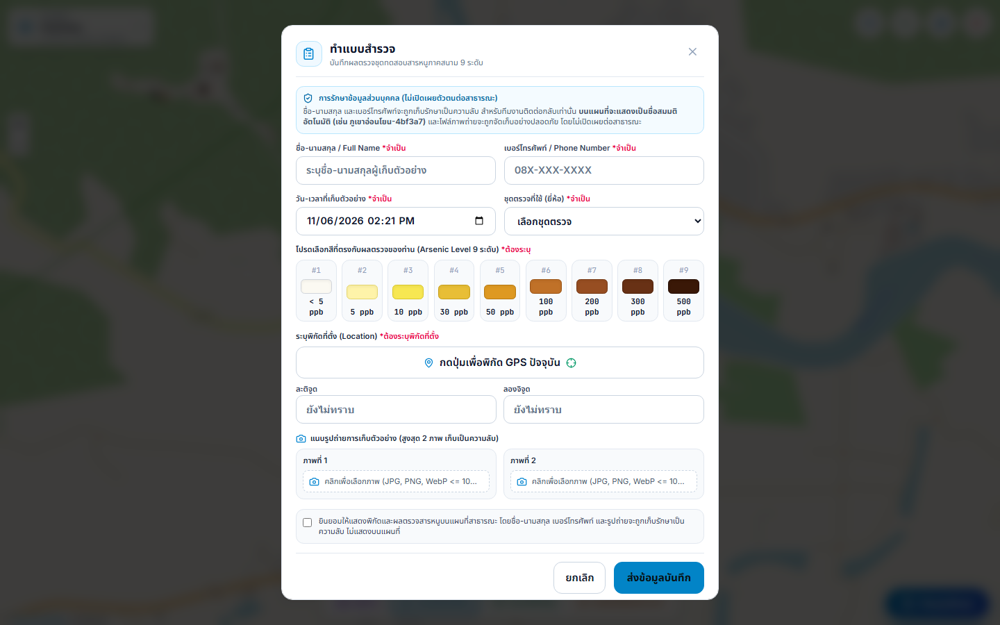
- **ผู้ใช้:** อาสาสมัครเฝ้าระวังน้ำ, ชาวบ้านที่ได้รับชุดตรวจ Strip Test, แกนนำชุมชน
- **สถานะ/ปัญหาเดิม:** ตรวจน้ำเสร็จแล้วจดใส่กระดาษ ข้อมูลสูญหาย ไม่ถูกส่งต่อให้ส่วนกลางหรือนักวิจัย มฟล. เพื่อวิเคราะห์ภาพรวม
- **สิ่งที่ได้กลับไป:** ฟอร์มบันทึกผลตรวจหน้าเดียว รองรับการดึงพิกัด GPS อัตโนมัติ, เลือกค่าสารหนู 9 ระดับตามแถบสีมาตรฐาน, แนบภาพถ่ายชุดตรวจ, ใส่ชื่อและเบอร์ติดต่อภายใน (ระบบคัดกรองอัตโนมัติ: <=50 ppb เผยแพร่ทันที / >50 ppb ส่งเข้าคิวตรวจทาน)
- **นำไปใช้ประโยชน์ต่อ:** ร่วมเป็นเครือข่ายวิทยาศาสตร์ภาคพลเมือง ส่งข้อมูลเข้าสู่ฐานข้อมูลกลางเพื่อแจ้งเตือนภัยคนทั้งลุ่มน้ำ

---

### 4. สรุปภาพรวมและสถิติคุณภาพน้ำ (Summary Analytics Quick Panel)
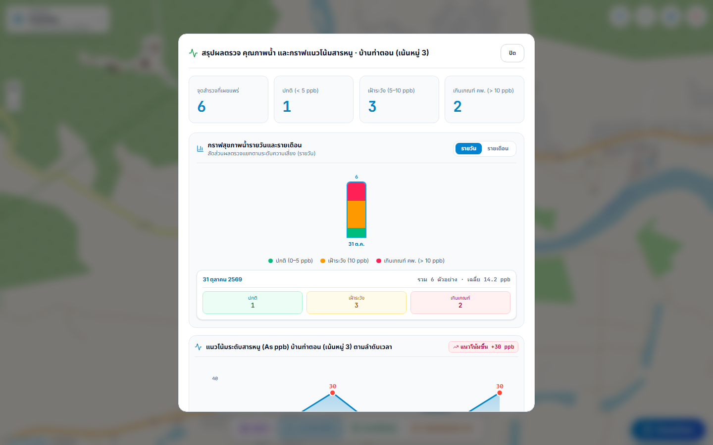
- **ผู้ใช้:** นักวิจัยท้องถิ่น, ผู้นำชุมชน, หน่วยงานปกครองส่วนท้องถิ่น (อปท.), ประชาชนทั่วไป
- **สถานะ/ปัญหาเดิม:** มองเห็นเป็นจุดเดี่ยว ๆ แต่ไม่เห็นภาพรวมของทั้งตำบลหรือลุ่มน้ำ ไม่รู้สัดส่วนว่าน้ำปลอดภัยหรือเกินเกณฑ์มากน้อยเพียงใด
- **สิ่งที่ได้กลับไป:** แดชบอร์ดสรุปสถิติด่วน, กราฟเปรียบเทียบสารหนูเทียบมาตรฐาน คพ., สัดส่วนตัวอย่างปลอดภัย/เฝ้าระวัง/เกินเกณฑ์, และการกระจายตัวของค่าตรวจในแต่ละช่วงเวลา
- **นำไปใช้ประโยชน์ต่อ:** ใช้รายงานสถานการณ์น้ำในที่ประชุมหมู่บ้าน หรือกำหนดมาตรการเฝ้าระวังเชิงพื้นที่ร่วมกับ อบต./เทศบาล

---

### 5. คู่มือและวิดีโอแนะนำการใช้งาน (Guide & Tutorial Video)
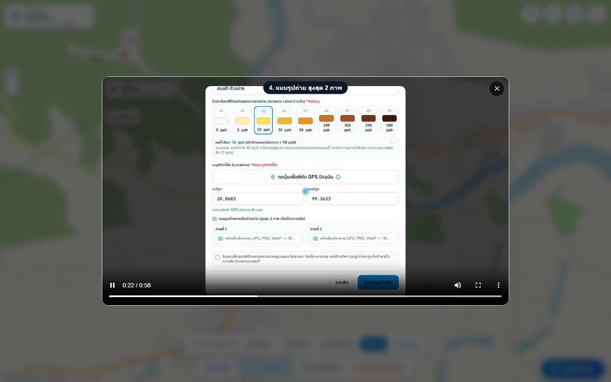
- **ผู้ใช้:** ชาวบ้านและผู้สูงอายุที่ไม่ถนัดใช้งานสมาร์ทโฟน, ผู้ใช้งานใหม่
- **สถานะ/ปัญหาเดิม:** ไม่เข้าใจความหมายของค่า ppb, ดูสีหมุดไม่เป็น, ไม่รู้วิธีส่งข้อมูลผ่านเว็บ
- **สิ่งที่ได้กลับไป:** วิดีโอสั้นสอนการใช้งานภาษาเข้าใจง่าย, คำอธิบายเกณฑ์ความปลอดภัยของสารหนู, ขั้นตอนการส่งผลตรวจ 3 ขั้นตอน, และคำแนะนำการปฏิบัติตัวเมื่อพบสารเคมีเกินเกณฑ์
- **นำไปใช้ประโยชน์ต่อ:** ลดช่องว่างทางดิจิทัล ช่วยให้ชาวบ้านทุกกลุ่มเข้าถึงข้อมูลเตือนภัยและใช้งานระบบได้ด้วยตนเอง

---

### 6. แผนที่ความเสี่ยงและโหมดอพยพชุมชน (Community Risk & Evacuation Map)
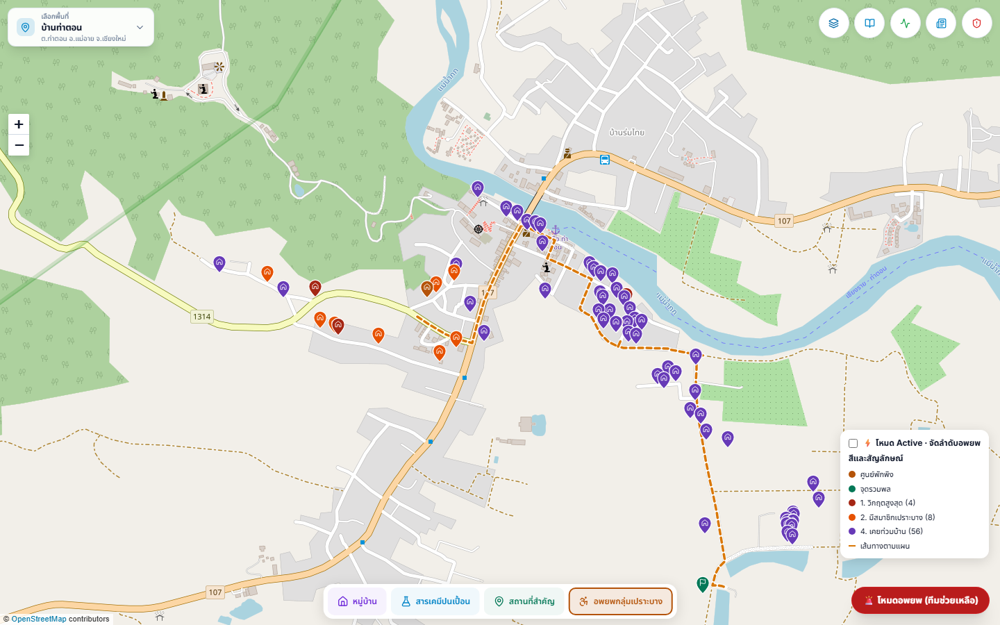
- **ผู้ใช้:** ประชาชนในพื้นที่เสี่ยงภัยน้ำท่วม/น้ำหลาก, ทีมกู้ภัยชุมชน
- **สถานะ/ปัญหาเดิม:** เวลาน้ำหลากไม่รู้ว่าจุดไหนปลอดภัย เส้นทางไหนจมน้ำ หรือศูนย์พักพิงอยู่ที่ใด
- **สิ่งที่ได้กลับไป:** แผนที่ชั้นข้อมูลความเสี่ยง, ตำแหน่งศูนย์พักพิงชั่วคราว, จุดรวมพล, เส้นทางอพยพตามแผนชุมชน, และข้อมูลศักยภาพการรองรับของแต่ละจุด
- **นำไปใช้ประโยชน์ต่อ:** เตรียมพร้อมรับมือน้ำท่วม อพยพคนและทรัพย์สินไปตามเส้นทางที่ปลอดภัยล่วงหน้า

---

### 7. ข่าวสารประชาสัมพันธ์และเตือนภัย (News & Warning Center)
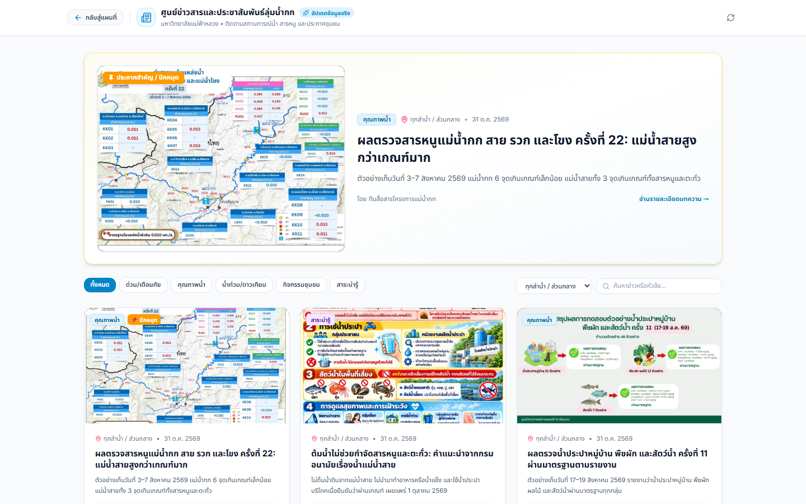
- **ผู้ใช้:** ประชาชนทั่วไปในลุ่มน้ำกก, สื่อมวลชน, นักวิชาการ
- **สถานะ/ปัญหาเดิม:** ได้รับข่าวลือเรื่องสารพิษหรือน้ำท่วมทางโซเชียลมีเดีย สับสน ไม่รู้ว่าข้อเท็จจริงเป็นอย่างไร
- **สิ่งที่ได้กลับไป:** ศูนย์รวมข่าวสารอย่างเป็นทางการจากมหาวิทยาลัยแม่ฟ้าหลวงและหน่วยงานพันธมิตร, ประกาศเตือนภัยฉุกเฉิน, บทความความรู้ด้านสุขภาพ, และช่องทางติดต่อประสานงาน
- **นำไปใช้ประโยชน์ต่อ:** รับข้อมูลที่ถูกต้อง แม่นยำ ไม่ตื่นตระหนก และปฏิบัติตามคำแนะนำของนักวิจัยได้อย่างเหมาะสม

---

## ส่วนที่ 2: หน้า Admin (ผู้ดูแลระบบ, ทีมวิจัย มฟล., เจ้าหน้าที่ อปท.)

### 8. ข้อมูลแผนที่หน้าบ้าน — ภาพรวม (Map Overview)
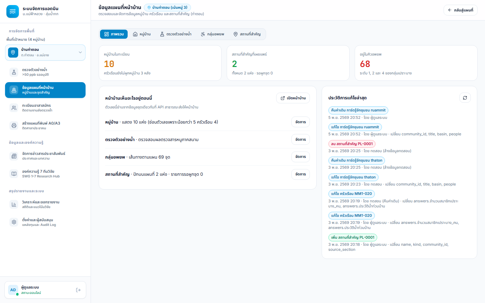
- **ผู้ใช้:** แอดมินระบบ, ผู้จัดการโครงการ มฟล.
- **สถานะ/ปัญหาเดิม:** ขาดจุดศูนย์กลางตรวจเช็กความสมบูรณ์ของข้อมูลแผนที่ทั้งหมดในแต่ละชุมชน
- **สิ่งที่ได้กลับไป:** KPI สรุปสถานะข้อมูล (จำนวนหมู่บ้าน, สถานที่สำคัญที่เผยแพร่, ครัวเรือนในคิวอพยพ), รายการตรวจสอบสิ่งที่หน้าบ้านเห็นจริง ณ ปัจจุบัน, และประวัติการแก้ไขข้อมูลล่าสุด (Audit Log)
- **นำไปใช้ประโยชน์ต่อ:** ตรวจสอบความพร้อมของข้อมูลเชิงพื้นที่ก่อนเผยแพร่สู่สาธารณะ และติดตามการทำงานของทีมงาน

---

### 9. ข้อมูลแผนที่หน้าบ้าน — หมู่บ้านและรู้จักชุมชน (Hamlets & Community Profiles)
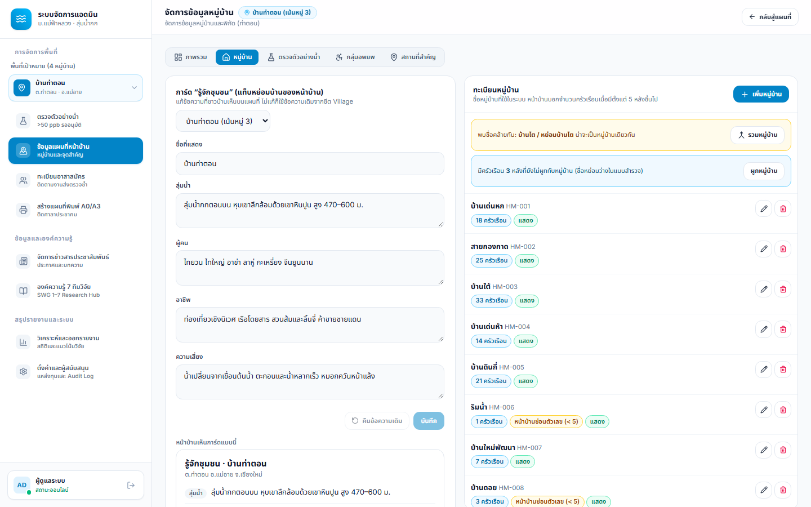
- **ผู้ใช้:** แอดมินพื้นที่, นักวิจัย SWG 5 (การจัดการความเสี่ยงภัยชุมชน)
- **สถานะ/ปัญหาเดิม:** ชุมชนมีหย่อมบ้านย่อยหลายชื่อที่เรียกซ้ำซ้อน ไม่มีพิกัดศูนย์กลาง และเนื้อหาแนะนำบริบทชุมชนไม่ตรงกับสภาพจริง
- **สิ่งที่ได้กลับไป:** ทะเบียนหย่อมบ้านพร้อมระบบแนะนำรวมชื่อซ้ำ (Fuzzy Match Merge), กำหนดพิกัดศูนย์กลางหมู่บ้าน, และระบบแก้ไขข้อความการ์ด "รู้จักชุมชน" (ลุ่มน้ำ, ผู้คน, อาชีพ, ความเสี่ยง)
- **นำไปใช้ประโยชน์ต่อ:** จัดระเบียบข้อมูลชุมชนให้ถูกต้องตามภูมิศาสตร์จริง และสะท้อนบริบทวิถีชีวิตเพื่อการสื่อสารสาธารณะ

---

### 10. ข้อมูลแผนที่หน้าบ้าน — ตรวจตัวอย่างน้ำ (Water Samples Moderation)
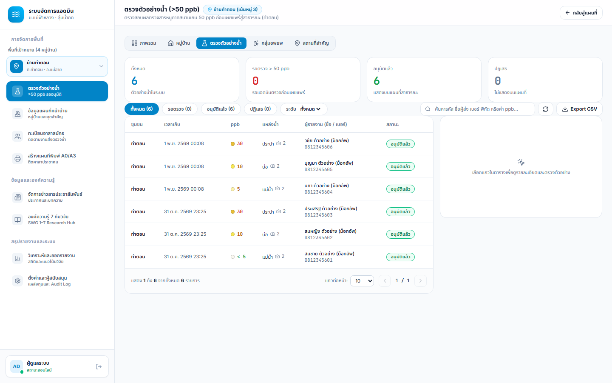
- **ผู้ใช้:** เจ้าหน้าที่ห้องปฏิบัติการ มฟล., ผู้ตรวจสอบคุณภาพข้อมูล (Moderator)
- **สถานะ/ปัญหาเดิม:** ตัวอย่างน้ำที่ค่าสารหนูวิกฤต (>50 ppb) หากหลุดขึ้นแผนที่ทันทีอาจทำให้สังคมตื่นตระหนก หรือหากเป็นผลบวกลวงจากชุดตรวจแถบสีจะส่งผลเสียต่อชุมชน
- **สิ่งที่ได้กลับไป:** ตารางคัดกรองตัวอย่างน้ำสด, แท็บแยกผลตรวจปกติและผลตรวจวิกฤต (>50 ppb), ระบบตรวจทานภาพถ่ายชุดตรวจ, ปุ่มอนุมัติเผยแพร่, ปุ่มปฏิเสธ, และระบบสั่งการส่งทีมตรวจซ้ำด้วยเครื่อง ICP-MS ในแล็บ
- **นำไปใช้ประโยชน์ต่อ:** ป้องกันข่าวปลอมหรือผลคลาดเคลื่อน ควบคุมมาตรฐานข้อมูลวิทยาศาสตร์ภาคพลเมือง และสั่งการทีมลงพื้นที่ตรวจยืนยันได้ทันที

---

### 11. ข้อมูลแผนที่หน้าบ้าน — กลุ่มอพยพและเส้นทาง (Evacuation Routes & Queues)
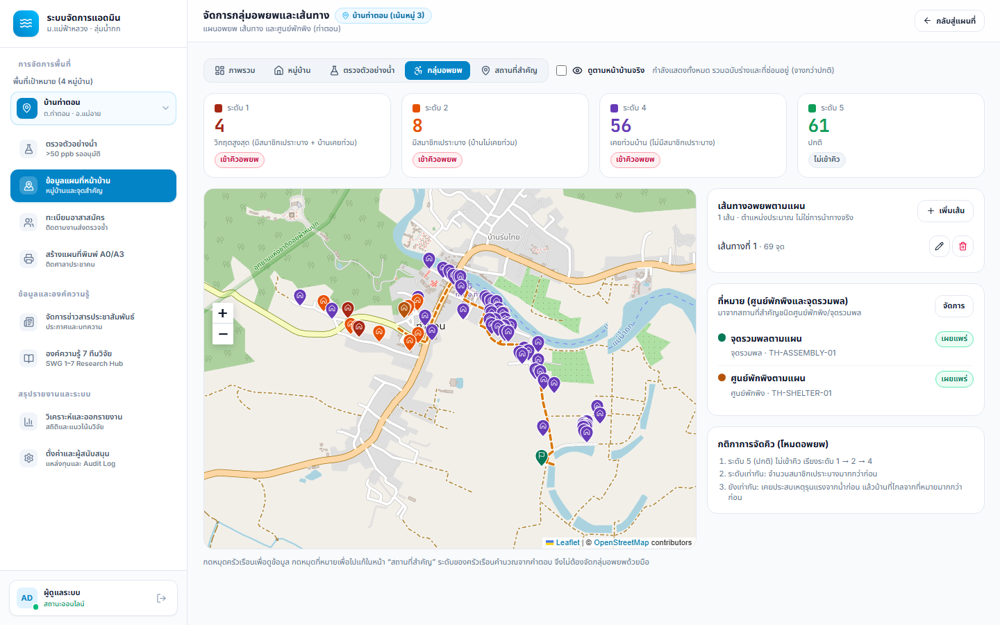
- **ผู้ใช้:** ฝ่ายป้องกันและบรรเทาสาธารณภัย (ปภ.), ทีมกู้ภัย, ผู้นำชุมชน
- **สถานะ/ปัญหาเดิม:** เส้นทางอพยพถูกวาดไว้ในกระดาษ ไม่สามารถปรับปรุงตามสภาพถนนที่เปลี่ยนไปได้ และไม่มีการจัดลำดับความเร่งด่วนของกลุ่มเปราะบาง
- **สิ่งที่ได้กลับไป:** แผนที่ดิจิทัลลากเส้นทางอพยพได้สด (Interactive Route Editor), การจัดคิวอพยพ 4 ระดับคำนวณจากสภาพบ้านและกลุ่มเปราะบางอัตโนมัติ, และการเชื่อมโยงเส้นทางไปยังศูนย์พักพิง
- **นำไปใช้ประโยชน์ต่อ:** ซักซ้อมแผนเผชิญเหตุน้ำท่วม และใช้วางแผนจัดยานพาหนะเข้าช่วยเหลือกลุ่มติดเตียง/คนชราได้ทันท่วงที

---

### 12. ข้อมูลแผนที่หน้าบ้าน — สถานที่สำคัญ (Important Places & Shelters)
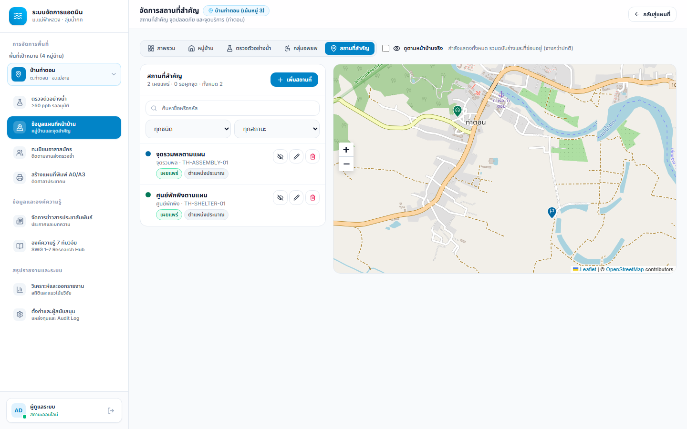
- **ผู้ใช้:** แอดมินระบบ, ผู้ประสานงาน อปท.
- **สถานะ/ปัญหาเดิม:** จุดปลอดภัย ศูนย์พักพิง หรือแหล่งน้ำประปาชุมชนไม่มีพิกัดที่แม่นยำ ไม่รู้ความจุที่รองรับได้
- **สิ่งที่ได้กลับไป:** ทะเบียนสถานที่สำคัญ 13 ประเภท (ศูนย์พักพิง, จุดรวมพล, จุดย้ายรถ, วัด, โรงเรียน ฯลฯ), เครื่องมือคลิกปักหมุดบนแผนที่, บันทึกความจุคน, ความแม่นยำพิกัด, และสถานะการเปิดใช้งาน
- **นำไปใช้ประโยชน์ต่อ:** บริหารจัดการจุดพักพิงและทรัพยากรฉุกเฉิน (น้ำดื่ม, อาหาร, ยา) ให้เพียงพอกับจำนวนผู้อพยพ

---

### 13. ทะเบียนอาสาสมัครและส่งทีมตรวจซ้ำ (Reporters Directory & Lab Re-inspection)
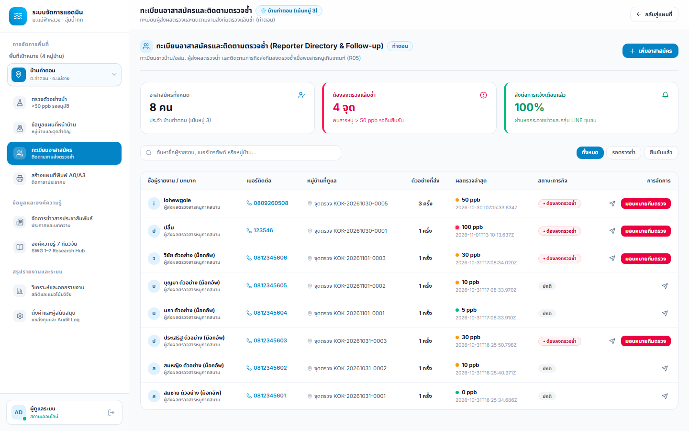
- **ผู้ใช้:** ผู้ประสานงานเครือข่ายอาสาสมัคร, หัวหน้าทีมห้องปฏิบัติการ มฟล.
- **สถานะ/ปัญหาเดิม:** ขาดการติดตามว่าใครส่งผลตรวจมาบ้าง ใครส่งบ่อย และเมื่อพบจุดวิกฤตจะติดต่อกลับหรือส่งทีมแล็บไปซ้ำได้อย่างไร
- **สิ่งที่ได้กลับไป:** ทะเบียนรายชื่อและเบอร์โทรอาสาสมัคร (ดึงอัตโนมัติจากผลตรวจจริง), สถิติจำนวนครั้งที่ส่งตรวจ, ระดับสารหนูสูงสุดที่เคยพบ, ระบบบันทึกสถานะการส่งทีมตรวจแล็บซ้ำ, และหมายเหตุการติดตามงาน
- **นำไปใช้ประโยชน์ต่อ:** ประสานงานส่งทีมวิทยาศาสตร์ลงเก็บตัวอย่างน้ำส่งเข้าแล็บใหญ่ มฟล. และบริหารจัดการเครือข่ายจิตอาสาในพื้นที่

---

### 14. จัดทำแผนที่พิมพ์ A0/A3 (Print Map Generator)
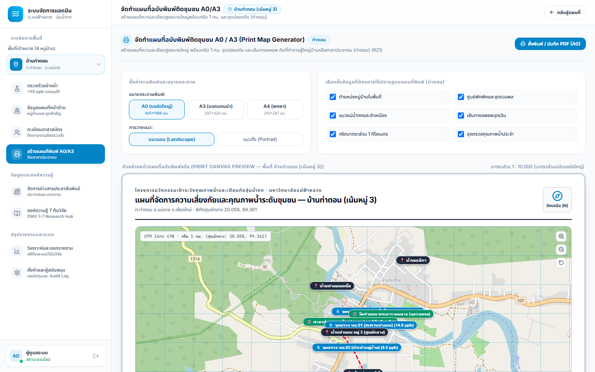
- **ผู้ใช้:** ผู้ใหญ่บ้าน, คณะกรรมการหมู่บ้าน, เจ้าหน้าที่ ปภ. ชุมชน
- **สถานะ/ปัญหาเดิม:** ชาวบ้านริมกกหลายคนไม่มีสมาร์ทโฟนหรือไม่มีเน็ต เมื่อเกิดภัยพิบัติระบบดิจิทัลเข้าไม่ถึง ต้องอาศัยป้ายไวนิลที่ศาลาประชาคม
- **สิ่งที่ได้กลับไป:** เครื่องมือเรนเดอร์แผนที่ความละเอียดสูง OpenStreetMap บนกระดาษขนาดมาตรฐาน (A0, A3, A4), วางแนวตั้ง/แนวนอน, พร้อมกริดมาตราส่วน UTM 1 กม., เลือกลงหมุดหมู่บ้าน, ศูนย์พักพิง, จุดตรวจน้ำ, และเส้นทางอพยพได้ตามต้องการ
- **นำไปใช้ประโยชน์ต่อ:** พิมพ์ติดบอร์ดศาลาประชาคม วัด หรือแจกจ่ายให้ผู้นำชุมชนใช้เป็นแผนที่สั่งการยามไฟดับหรือสัญญาณเน็ตล่ม

---

### 15. จัดการข่าวสารประชาสัมพันธ์ (News & Announcements Management)
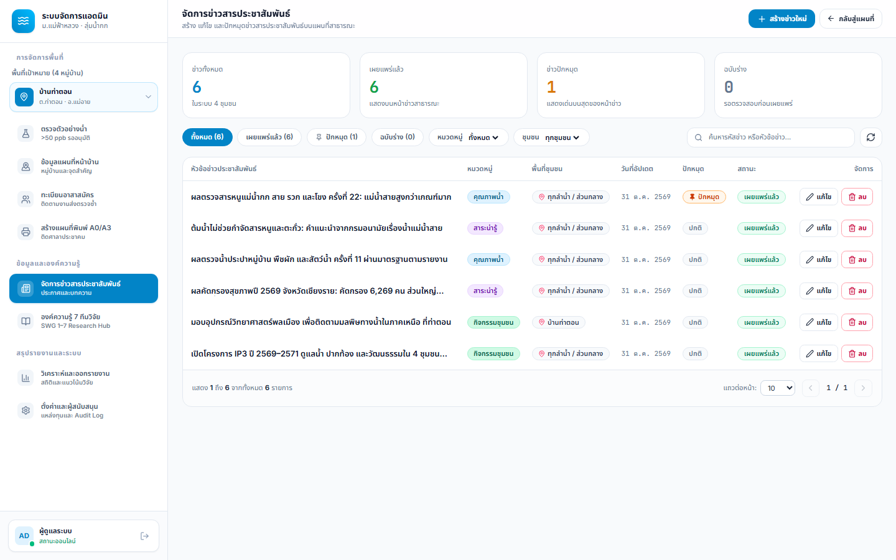
- **ผู้ใช้:** ทีมสื่อสารองค์กร มฟล., แอดมินข่าวสาร
- **สถานะ/ปัญหาเดิม:** การสื่อสารข่าวเตือนภัยกระจัดกระจาย ประชาชนไม่ทราบช่องทางข่าวสารที่น่าเชื่อถือ
- **สิ่งที่ได้กลับไป:** ระบบ CMS จัดการข่าวสาร, เขียนเนื้อหาพร้อมแนบภาพปก, กำหนดหมวดหมู่ (ประกาศเตือนภัย, ข่าวสาร, สาระความรู้), ระบบปักหมุดข่าวสำคัญ, และเปิด/ปิดการเผยแพร่ทันที
- **นำไปใช้ประโยชน์ต่อ:** แจ้งเตือนสถานการณ์น้ำสารเคมีปนเปื้อนและอุทกภัยให้ประชาชนรับทราบอย่างรวดเร็วและเป็นทางการ

---

### 16. องค์ความรู้ 7 ทีมวิจัย (SWG 1–7 Research Hub CMS)
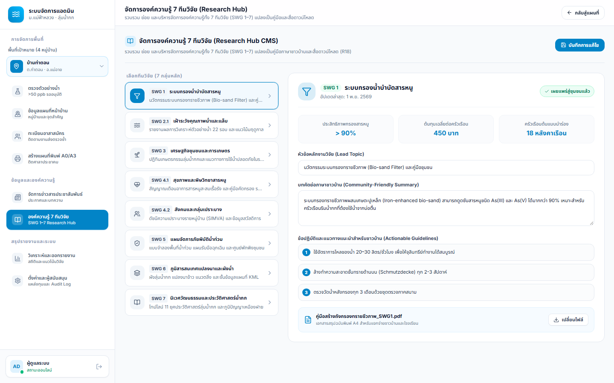
- **ผู้ใช้:** นักวิจัยโครงการลุ่มน้ำกก มฟล., ผู้เชี่ยวชาญ 7 ด้าน
- **สถานะ/ปัญหาเดิม:** ผลงานวิจัยทางวิชาการอ่านยาก เป็นภาษาเชิงเทคนิค ชาวบ้านนำไปปรับใช้จริงไม่เป็น
- **สิ่งที่ได้กลับไป:** ระบบจัดการองค์ความรู้ 7 กลุ่มวิจัย (SWG 1 คุณภาพน้ำ, SWG 2 ตะกอนดิน, SWG 3 สุขภาพ, SWG 4 นิเวศเกษตร, SWG 5 ความเสี่ยงภัย, SWG 6 ฐานข้อมูล GIS, SWG 7 นโยบาย), แปลงเป็น "บทคัดย่อภาษาชาวบ้าน" และ "แนวทางปฏิบัติที่ทำได้ทันที"
- **นำไปใช้ประโยชน์ต่อ:** ถ่ายทอดความรู้ทางวิทยาศาสตร์สู่ชุมชน เปลี่ยนงานวิจัยบนหิ้งให้กลายเป็นการปฏิบัติที่ปกป้องชีวิตเกษตรกรได้จริง

---

### 17. ศูนย์วิเคราะห์ข้อมูลและออกรายงานวิจัย (Analytics & Reports)
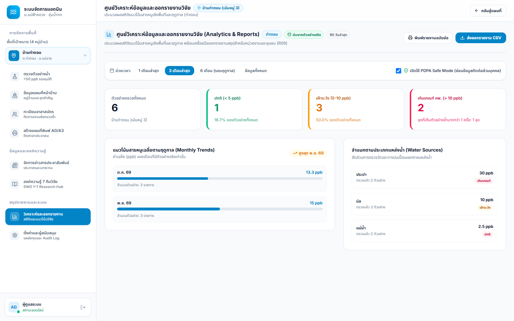
- **ผู้ใช้:** นักสถิติ, ผู้ประเมินโครงการ, หน่วยงานระดับจังหวัด/กรม
- **สถานะ/ปัญหาเดิม:** ข้อมูลตัวอย่างน้ำกระจัดกระจาย การทำรายงานสรุปประจำเดือนหรือประจำฤดูกาลต้องใช้เวลานานและผิดพลาดง่าย
- **สิ่งที่ได้กลับไป:** สรุปสถิติเชิงพื้นที่และฤดูกาลแบบ Live Database (นับจริงตามพิกัดและช่วงเวลา), จำแนกประเภทแหล่งน้ำ (แม่น้ำ, บ่อ, ประปา), แนวโน้มสารหนูรายเดือน, ตัวเลือก PDPA Safe Mode, และปุ่มส่งออกข้อมูลดิบเป็นไฟล์ CSV ทันที
- **นำไปใช้ประโยชน์ต่อ:** ใช้ประกอบรายงานวิชาการ เสนอของบประมาณฟื้นฟูลุ่มน้ำ หรือเสนอเชิงนโยบายต่อผู้ว่าราชการจังหวัดและกรมควบคุมมลพิษ

---

### 18. ตั้งค่าและผู้สนับสนุน (Settings, Sponsors & Audit Log)
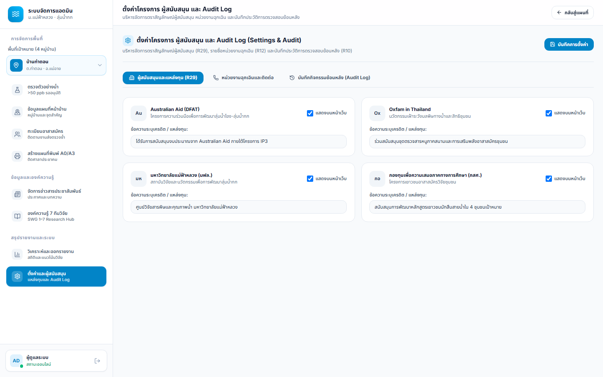
- **ผู้ใช้:** ผู้ดูแลระบบสูงสุด (Super Admin), ผู้ตรวจสอบระบบ
- **สถานะ/ปัญหาเดิม:** ขาดการตรวจสอบความโปร่งใส ไม่รู้ว่าใครเข้ามาแก้ไขข้อมูลเมื่อไหร่ และตราสัญลักษณ์ผู้ให้ทุนไม่เป็นปัจจุบัน
- **สิ่งที่ได้กลับไป:** จัดการตราสัญลักษณ์หน่วยงานผู้สนับสนุนและพันธมิตร (มฟล., สกสว., อว., SDC), จัดการเบอร์โทรหน่วยงานฉุกเฉิน, และระบบ Live Audit Log บันทึกทุกประวัติการ เพิ่ม/แก้ไข/ลบ ข้อมูลในระบบพร้อม Timestamp และชื่อผู้ดำเนินการ
- **นำไปใช้ประโยชน์ต่อ:** รักษาความโปร่งใส ความถูกต้องตามหลักธรรมาภิบาลข้อมูล และให้เกียรติหน่วยงานผู้สนับสนุนโครงการวิจัย
