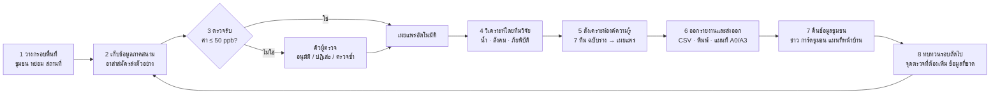

# ทีมวิจัยในระบบ: เวิร์กโฟลว์ และหน้าแสดงข้อมูลสำหรับทีมวิจัย

เขียนเมื่อ 2026-11-16 จากโค้ดและข้อมูลจริงของโปรเจกต์ และข้อกำหนด R07, R09, R18, R26 ใน `KokData/design-review-2026-10-15/REQUIREMENTS.md` ส่วนไหนเป็นข้อเสนอที่ยังไม่มีในระบบ ระบุไว้ชัดในข้อ 5

**แผนภาพ Excalidraw ประกอบเอกสารนี้:** `docs/diagrams/research-team-workflow.excalidraw` (เวิร์กโฟลว์ผลตรวจน้ำ → ทีมวิจัย → ชุมชน พร้อมไฟล์หลักฐาน `.claims.json`) และ `docs/diagrams/research-data-console.excalidraw` (ร่างหน้าศูนย์ข้อมูลทีมวิจัย) มีภาพ `.png` คู่กัน

## 1. ระบบตอนนี้ (ตรวจแล้ววันนี้)

| เรื่อง | สภาพจริง |
|---|---|
| เทคโนโลยี | Nuxt 4 + Nuxt UI + Leaflet หน้าบ้าน, Express ใน Nitro, MongoDB (รูปใน GridFS), deploy บน Vercel Hobby |
| ขนาด | หน้าจอ/คอมโพเนนต์ 47 ไฟล์ ~12,000 บรรทัด, API 52 ไฟล์ ~7,200 บรรทัด, กติกากลาง `src/lib` 28 ไฟล์ |
| ข้อจำกัดสำคัญ | Vercel Hobby รับฟังก์ชันได้ 12 ตัว ตอนนี้ครบ 12 พอดี ทุกงานใหม่ต้องเดินผ่านฟังก์ชันเดิมด้วย `?route=` |
| สถานะ git | branch `main` เท่ากับ origin (0 ahead / 0 behind) แต่มีไฟล์แก้ค้าง 52 รายการ (37 แก้ไข, 14 ใหม่, 1 ลบ) จากหลาย session ที่ยังไม่ commit |
| ทดสอบ | รายงานล่าสุดใน `memory.md` (2026-11-16): `tsc` ผ่าน, vitest 28 ไฟล์ 200 ข้อผ่าน, e2e 10 ไฟล์ |
| ข้อมูลจริงในฐานข้อมูล dev | จุดตรวจน้ำที่เผยแพร่มีเพียง 10 จุด (ค่า 0–50 ppb) จึงยังเป็นชุดทดลอง ไม่ใช่ผลภาคสนามครบ |

**ส่วนที่ทีมวิจัยใช้อยู่แล้วในระบบ**
- ทะเบียนบทบาท `ทีมวิจัยและจัดการข้อมูล` (`researcher`): แก้ได้ที่ ภาพรวม, หมู่บ้าน, กลุ่มอพยพ, สถานที่สำคัญ, แผนที่พิมพ์, ข่าว, องค์ความรู้ 7 ทีม, รายงาน; ดูได้ที่ ตรวจตัวอย่างน้ำ และ ทะเบียนอาสาสมัคร (`src/lib/admin-rbac.js`)
- หน้า "องค์ความรู้ 7 ทีมวิจัย" (`KokAdminResearchHub.vue`): จัดเนื้อหา SWG 1, 2.1, 3, 4.1, 4.2, 5, 6, 7 พร้อมหัวข้อ แนวปฏิบัติ ตัวเลขสำคัญ สถานะฉบับร่าง/เผยแพร่
- หน้า "วิเคราะห์และออกรายงาน" (`KokAdminReports.vue` + `/api/admin/reports/analytics`): สรุปผลตรวจน้ำตามชุมชนและช่วงเวลา (จำนวน, สัดส่วนปกติ/เฝ้าระวัง/เกินเกณฑ์, ค่าเฉลี่ย, จำนวนตรวจซ้ำ, แหล่งน้ำ, แนวโน้มรายเดือน) ส่งออก CSV และพิมพ์ได้

**ข้อควรระวังจากการตรวจก่อนหน้า** (บันทึกใน `memory.md` วันเดียวกัน): ช่องโหว่ npm ระดับสูง 4 รายการ, ไม่มี security headers ใน `vercel.json`, ไฟล์สำรวจรายครัวเรือนใน `public/` ยังดาวน์โหลดได้, ล็อกอินแอดมินยังไม่มีการจำกัดครั้ง รายการแรกที่รายงานว่าสิทธิ์รายหน้าไม่ถูกบังคับฝั่งเซิร์ฟเวอร์ ตอนนี้โค้ดมีการตรวจสิทธิ์รายหน้าและรายชุมชนใน `_admin_shared.js` แล้ว (ผมตรวจเพียงบางส่วน ยังไม่ได้ทดสอบทุกเส้นทาง)

## 2. ใครเกี่ยวข้อง

| บทบาท | ทำอะไรในระบบ | สิทธิ์ที่ใช้ |
|---|---|---|
| อาสาสมัคร / ผู้นำชุมชน | เก็บตัวอย่าง ใช้ชุดตรวจสี 9 ระดับ ถ่ายรูป GPS ส่งแบบสำรวจ | ไม่ต้องล็อกอิน (จำกัดอัตราต่อ IP, ลงนาม HMAC) |
| ผู้ตรวจและอนุมัติผลน้ำ (`reviewer`) | ตรวจผล >50 ppb อนุมัติ/ปฏิเสธ แก้ค่า ติดต่อผู้ส่งกลับ | ตรวจตัวอย่างน้ำ = แก้ได้ |
| **ทีมวิจัย (`researcher`)** | วิเคราะห์ข้อมูล สรุปองค์ความรู้ 7 ทีม ออกรายงาน คืนข้อมูลให้ชุมชน | รายงาน/องค์ความรู้/ข่าว = แก้ได้ |
| ผู้ดูข้อมูล (`viewer`) | ดูสถิติและรายงานอย่างเดียว | ดูได้ทุกหน้าที่เปิด |
| ผู้ดูแลระบบสูงสุด | จัดการผู้ใช้ บทบาท ตั้งค่า | ทุกหน้า |

## 3. เวิร์กโฟลว์ของทีมวิจัย



| ขั้น | ผู้ทำ | ทำอะไร | หน้าในระบบ | เงื่อนไขผ่านขั้น |
|---|---|---|---|---|
| 1 วางกรอบพื้นที่ | ทีมวิจัย | ตั้งหย่อม สถานที่สำคัญ ที่หมายอพยพ เส้นทาง การ์ดรู้จักชุมชน | ข้อมูลแผนที่ (หมู่บ้าน, สถานที่, กลุ่มอพยพ) | สถานที่ไม่มีพิกัดต้องอยู่ในรายการ "รอผูกจุด" ไม่ปักเดา |
| 2 เก็บข้อมูลภาคสนาม | อาสาสมัคร | ส่งค่า ppb ตามแถบสี 9 ระดับ พิกัด รูป ผู้ส่งติดต่อกลับได้ | หน้าแผนที่ปุ่ม "ทำแบบสำรวจ" | มีพิกัดและรูป ผ่านการจำกัดอัตราและลายเซ็น |
| 3 ตรวจรับ | ผู้ตรวจ | ≤50 ppb เผยแพร่เอง; >50 ppb รออนุมัติ แก้ค่า ขอตรวจซ้ำ | ตรวจตัวอย่างน้ำ | 50 ppb เป็นเกณฑ์ส่งตรวจ ไม่ใช่รับรองน้ำดื่มปลอดภัย; เหตุผลอนุมัติ/ปฏิเสธถูกบันทึก |
| 4 วิเคราะห์ | ทีมวิจัย | ดูแนวโน้ม แยกตามสถานี/แหล่งน้ำ/ฤดู เทียบกับข้อมูลสังคม | วิเคราะห์และออกรายงาน (ดูข้อ 4) | เส้นแนวโน้มเชื่อมเฉพาะชุดที่เทียบกันได้ (สถานีเดียวกัน วิธีเดียวกัน หน่วยเดียวกัน) ตามข้อ R07 |
| 5 สังเคราะห์องค์ความรู้ | ทีมวิจัยแต่ละ SWG | สรุปผลผลิตของทีม แปลเป็นไทยอ่านง่าย คงที่มา | องค์ความรู้ 7 ทีมวิจัย | แยกชัดว่าเป็นรายงาน ผลวัด หรือคำสัมภาษณ์ ไม่อ้างประสิทธิภาพที่ยังไม่รับรอง (R18) |
| 6 ออกรายงาน | ทีมวิจัย | เลือกชุดข้อมูล ช่วงเวลา ตัวส่วน ส่งออกหรือพิมพ์ | วิเคราะห์และออกรายงาน, สร้างแผนที่พิมพ์ | ทุกตัวเลขมีตัวส่วนและช่วงเวลา; ไฟล์สาธารณะไม่มีชื่อ เบอร์ พิกัดบ้าน (R09) |
| 7 คืนข้อมูลชุมชน | ทีมวิจัย + ผู้ประสานงาน | ข่าวประชาสัมพันธ์ การ์ดชุมชน แผนที่ติดศาลาประชาคม | จัดการข่าว, หมู่บ้าน, แผนที่พิมพ์ | ผู้ประสานงานท้องถิ่นตรวจภาษาและข้อเท็จจริงก่อนเผยแพร่ |
| 8 ทบทวน | ทีมวิจัย | ดูช่องว่างข้อมูล จุดที่ต้องตรวจเพิ่ม | หน้าแสดงข้อมูลทีมวิจัย ส่วน "คุณภาพข้อมูล" | มีรายการงานค้างที่ระบุเจ้าของ |

**กติกาที่ใช้ทุกขั้น** (จาก `PRODUCT.md`): แสดงเฉพาะข้อมูลที่มีหลักฐานจริง ไม่ปั้นข้อมูลเทียม ไม่ผสมตัวส่วนคนละชุด (เช่น 109 ครัวเรือนเศรษฐกิจ, 129 แถวสำรวจท่าตอน, 166 ผู้ตอบสุขภาพ) ข้อมูลส่วนบุคคลและพิกัดรายครัวเรือนไม่ออกสู่สาธารณะ

## 4. หน้า "ศูนย์ข้อมูลทีมวิจัย": นำเสนออะไร

เป็นหน้าอ่านและวิเคราะห์สำหรับทีมวิจัย ต่อยอดจากหน้า "วิเคราะห์และออกรายงาน" เดิม จัดเป็น 6 ส่วน เลื่อนลงตามลำดับงาน มีตัวกรองกลางบนสุด (ชุมชน · ช่วงเวลา · สถานะ) ที่มีผลกับทุกส่วน

```
┌ ศูนย์ข้อมูลทีมวิจัย ─ [ชุมชน ▾] [ช่วงเวลา ▾] [สถานะ ▾]      [พิมพ์] [ส่งออก ▾] ┐
│ ① สถานะข้อมูล   ตัวอย่างทั้งหมด · เผยแพร่ · รอตรวจ · ปฏิเสธ · ตรวจซ้ำ │ ปัญหาคุณภาพ  │
│ ② ผลน้ำ         KPI 4 ช่อง │ แผนที่จุดตรวจ │ แนวโน้มตามสถานี/วิธี    │ ตามแหล่งน้ำ  │
│ ③ สังคมและความเปราะบาง   6 หัวข้อ แท่งซ้อน (ตัวส่วน 129) │ ตามหย่อม (k≥5)        │
│ ④ ภัยพิบัติและอพยพ      ในคิว 68 · ที่หมาย · เส้นทาง · ที่ยังรอพิกัด            │
│ ⑤ องค์ความรู้ 7 ทีม     ทีม → ผลผลิต → ข้อมูล → requirement → หน้าชุมชน          │
│ ⑥ รายงานและส่งออก       เลือกชุดข้อมูล → ตรวจตัวส่วน → ส่งออก/พิมพ์ + บันทึกการส่งออก │
└──────────────────────────────────────────────────────────────────────────────┘
```

มือถือ: ตัวกรองยุบเป็นปุ่มเดียว ทุกส่วนเรียงลงเป็นการ์ดเต็มกว้าง กราฟมีตารางตัวเลขสลับดูได้

### ① สถานะข้อมูล (ตอบว่า "ข้อมูลพอให้สรุปหรือยัง")
- ตัวเลข: ตัวอย่างทั้งหมด, เผยแพร่ (≤50 ppb อัตโนมัติ + อนุมัติแล้ว), รอตรวจ (>50 ppb), ปฏิเสธ, ตรวจซ้ำแล้ว
- ความครอบคลุม: จำนวนตัวอย่างต่อชุมชนและต่อสถานี ช่วงวันที่เก็บล่าสุด/เก่าสุด
- **ตารางปัญหาคุณภาพ** (QA issues): ไม่มีพิกัดหรือความแม่นยำ GPS ต่ำ, ไม่มีรูป, ไม่ระบุแหล่งน้ำ, ค่าซ้ำจากพิกัดเดียวกัน, ค้างรอตรวจเกินกำหนด แต่ละแถวกดไปที่ตัวอย่างนั้นได้
- ถ้ามีตัวอย่างน้อยกว่าเกณฑ์สรุป (เสนอ n < 5 ต่อสถานี) แสดงป้าย "ข้อมูลน้อย ยังสรุปแนวโน้มไม่ได้" แทนกราฟ

### ② ผลน้ำ (SWG 2.1)
- KPI 4 ช่อง: ปกติ (<5 ppb), เฝ้าระวัง (5–10), เกินเกณฑ์ (>10), ค่าเฉลี่ย ทุกช่องมี n และช่วงเวลากำกับ (ใช้ API เดิมได้ทั้งหมด)
- แผนที่จุดตรวจสีตามระดับ 9 ระดับของแถบสี
- **แนวโน้มตามชุดที่เทียบกันได้**: หนึ่งเส้นต่อ (สถานี, วิธีตรวจ, หน่วย) ไม่ลากเส้นข้ามสถานีหรือวิธีที่ต่างกัน ช่วงไม่มีข้อมูลแสดงข้อความ ไม่วาดเป็น 0 (R07) ค่าต่ำกว่าขีดจำกัดการตรวจแสดงเป็น "<ค่าขีดจำกัด"
- แยกตามแหล่งน้ำ (ประปาภูเขา น้ำบ่อ น้ำแม่น้ำ ฯลฯ) และตามบริบทฝน/ฤดู (ข้อมูล `rain_context` และเดือนที่เก็บ)
- เทียบ "ชุดตรวจสี" กับ "ผลแล็บ" เมื่อมีทั้งสองสำหรับตัวอย่างเดียวกัน เพื่อดูว่าชุดตรวจภาคสนามเชื่อถือได้เพียงใด (ใช้ได้เมื่อมีผลแล็บนำเข้า)
- ป้ายกำกับทุกกราฟ: ที่มา, วิธีตรวจ, ช่วงเวลา, n

### ③ สังคมและความเปราะบาง (SWG 4.2, 4.1)
- 6 หัวข้อแบบสำรวจท่าตอน เป็นแท่งซ้อนตามระดับ (สีเดียวกับหน้าบ้าน) ตัวส่วนคงที่ 129 แถว ตัวอย่างที่ตรวจตรงกับข้อมูลแล้ว: เคยท่วมบ้าน 60 จาก 129
- ตารางไขว้ 2 ตัวแปร เช่น เคยท่วมบ้าน × มีสมาชิกเปราะบาง, ไม่ปลอดภัยต่อการใช้น้ำ × ใช้น้ำแม่น้ำตรง
- แยกตามหย่อม โดยซ่อนจำนวนที่น้อยกว่า 5 ครัวเรือน (กติกาเดียวกับหน้าบ้าน)
- ไม่แสดงพิกัดหรือคำตอบรายบ้านในหน้านี้ แสดงเฉพาะยอดรวม

### ④ ภัยพิบัติและอพยพ (SWG 5)
- จำนวนครัวเรือนในคิวอพยพต่อระดับ (ตอนนี้ 4 / 8 / 56 รวม 68) และระยะเฉลี่ยถึงที่หมายที่ใกล้ที่สุด
- ที่หมาย (ศูนย์พักพิง จุดรวมพล) ความจุตามแผน (ไม่บอกว่าว่างวันนี้), รายการสถานที่ที่ยังรอพิกัด, จำนวนจุดของเส้นทางอพยพ
- ไม่คำนวณเส้นทางปลอดภัยเอง (ข้อ R16)

### ⑤ องค์ความรู้ 7 ทีม (R18)
- ตารางทีม → ผลผลิต → ชุดข้อมูล → requirement ที่สนับสนุน → หน้าชุมชนที่ใช้ พร้อมเจ้าของ, สถานะ (ฉบับร่าง/เผยแพร่), วันที่แก้ล่าสุด, ที่มา
- ตัวนับ: กี่ทีมเผยแพร่แล้ว กี่ทีมยังเป็นฉบับร่าง ผลผลิตไหนยังไม่ผูกกับ requirement ใด

### ⑥ รายงานและส่งออก (R09)
- ขั้นตอน: เลือกชุดข้อมูล (น้ำ / สังคม / อพยพ) → ระบบโชว์ตัวส่วนและช่วงเวลาให้ยืนยัน → ส่งออก CSV หรือพิมพ์ฉบับย่อ
- ทุกไฟล์มีหัวระบุ `dataset_version`, ช่วงเวลา, ตัวส่วน, วันที่สร้าง, ผู้สร้าง
- CSV สาธารณะมีเฉพาะคอลัมน์ที่อนุญาต (ไม่มีชื่อ เบอร์ พิกัดบ้าน)
- บันทึกการส่งออกทุกครั้ง (ใคร ชุดไหน เมื่อไหร่) ดูได้ในหน้าตั้งค่า/Audit Log

## 5. ช่องว่างระหว่างที่ออกแบบกับที่ระบบมี

| ส่วน | มีแล้ว | ต้องเพิ่ม |
|---|---|---|
| ① สถานะข้อมูล | จำนวนรวม/เผยแพร่/รอตรวจ ใน API คิวตัวอย่าง | ตารางปัญหาคุณภาพ, ความครอบคลุมต่อสถานี |
| ② ผลน้ำ | KPI, แหล่งน้ำ, แนวโน้มรายเดือน (API รายงานเดิม) | แนวโน้มแยกชุดเทียบกันได้ (ต้องมีเวอร์ชันสถานีและวิธีตรวจในข้อมูล), แผนที่ในหน้า, เทียบชุดตรวจกับแล็บ |
| ③ สังคม | กติกาและข้อมูล 6 หัวข้อพร้อมใช้ (`src/lib/map-data.js`) | หน้าแสดงแท่งซ้อน/ตารางไขว้ (คำนวณจากครัวเรือนในฐานข้อมูลได้เลย) |
| ④ อพยพ | จำนวนในคิว ที่หมาย เส้นทาง (หน้า "กลุ่มอพยพ") | การ์ดสรุปในหน้านี้ |
| ⑤ องค์ความรู้ | หน้า Research Hub เนื้อหาต่อทีม | ทะเบียนทีม→ผลผลิต→ข้อมูล→requirement (many-to-many) และเจ้าของ/revision |
| ⑥ ส่งออก | CSV และพิมพ์ฉบับย่อ | `dataset_version`, ตัวส่วนในไฟล์, allowlist คอลัมน์สาธารณะ, บันทึกการส่งออก; **PDF/Excel ยังไม่มี** (ระบุในบันทึกว่า export ปัจจุบันเป็น CSV เท่านั้น) |

ข้อมูลน้ำในฐานข้อมูลตอนนี้มีเพียง 10 จุดทดลอง หน้านี้จึงต้องแสดงสถานะ "ข้อมูลน้อย" ให้ชัดจนกว่าจะมีผลภาคสนามจริง ห้ามวาดแนวโน้มจากข้อมูลทดลอง

## 6. ลำดับทำ (เสนอ)

1. **ระยะ 1 (ใช้ของเดิมเกือบทั้งหมด)**: ส่วน ① ② ③ ④ จากข้อมูลที่มี + ตัวกรองกลาง; เพิ่ม endpoint ผ่านฟังก์ชันรายงานเดิม (`api/admin/review.js` dispatcher) ไม่เพิ่มฟังก์ชัน Vercel
2. **ระยะ 2**: ตาราง QA และ `dataset_version` + allowlist ส่งออก + บันทึกการส่งออก
3. **ระยะ 3**: แนวโน้มชุดที่เทียบกันได้ (ต้องตกลงโครงข้อมูลสถานีกับทีม GIS ก่อน), เทียบชุดตรวจกับแล็บ, ทะเบียนทีม→ผลผลิต→requirement
4. PDF/Excel เมื่อทีมยืนยันรูปแบบรายงาน

## 7. คำถามที่ต้องให้ทีมตัดสิน
1. เกณฑ์ "ข้อมูลน้อยเกินสรุป" ต่อสถานีคือกี่ตัวอย่าง (เสนอ 5)
2. ทีมวิจัยต้องการส่งออก PDF/Excel รูปแบบไหนเป็นลำดับแรก (ตอนนี้มีเฉพาะ CSV)
3. ผลแล็บ (รอบที่ 22 ฯลฯ) จะนำเข้าระบบเมื่อไร และใครเป็นผู้ตรวจรับ (ข้อ R07 ระบุว่ายังไม่ได้ตรวจตัวเลขทุกเซลล์กับต้นฉบับ)
4. ผู้ใช้บทบาทผู้ดูข้อมูล ควรเห็นส่วน ⑥ ส่งออกหรือไม่
